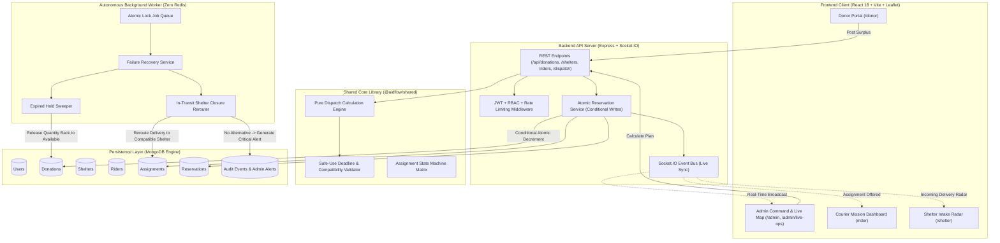

# AidFlow | Live Hackathon Judging Guide & Technical Documentation

**Prepared for Live Hackathon Evaluation & System Demonstration**  
**Repository:** `ResQLogistics-Smart-Aid-Redistribution-System`  
**Architecture:** Zero-Redis Node.js Workspaces Monorepo (Express API, React + Leaflet Live Ops, MongoDB-backed Worker Queue, Socket.IO)

---

## 📋 Table of Contents
1. [Executive Summary & Problem Statement](#1-executive-summary--problem-statement)
2. [Deterministic Demo Credentials](#2-deterministic-demo-credentials)
3. [Verified Environment Variables](#3-verified-environment-variables)
4. [Step-by-Step Setup Instructions](#4-step-by-step-setup-instructions)
5. [System Architecture & Data Flow](#5-system-architecture--data-flow)
6. [Scenario-by-Scenario Results Checklist (All 10 Scenarios)](#6-scenario-by-scenario-results-checklist)
7. [Live Demonstration Script for Judges](#7-live-demonstration-script-for-judges)
   - [7.1 Happy Path: Donation to Shelter Intake](#71-happy-path-end-to-end-donation-to-shelter-intake)
   - [7.2 Failure-Recovery: In-Transit Shelter Closure & Automatic Reroute](#72-failure-recovery-in-transit-shelter-closure--reroute)
8. [Honest Status Assessment & Production Readiness](#8-honest-status-assessment--production-readiness)

---

## 1. Executive Summary & Problem Statement

Millions of pounds of wholesome, prepared food and perishable produce are wasted daily by commercial kitchens, grocers, and bakeries due to rigid donation logistics. Meanwhile, emergency relief shelters experience critical supply deficits, erratic deliveries, and lack real-time visibility into incoming shipments.

**AidFlow solves this crisis with a real-time, concurrency-safe aid redistribution engine:**
- **Zero-Redis Architecture:** Completely eliminates Redis and BullMQ dependencies. Both the background task queue and transactional inventory reservations are executed natively with **atomic MongoDB operations** (`findOneAndUpdate` with `$gte` guards).
- **Separation of Pure Math & Persistence:** Pure dispatch route calculations (multi-shelter demand splitting, rider capacity capping, storage compatibility, and safe-use deadline validation) are strictly decoupled from transactional database commits.
- **Strict Food-Safety Guarantees:** Perishable aid with expiring safe-use deadlines is guaranteed never to be routed to trips exceeding the safety window.
- **Dynamic In-Transit Failure Recovery:** If a shelter abruptly closes while a courier is in transit, AidFlow autonomously identifies compatible neighboring shelters and reroutes deliveries in real time.
- **100% End-to-End Real MongoDB Testing:** Tested directly against real MongoDB and live Express services, not frontend mock shims.

---

## 2. Deterministic Demo Credentials

The database contains pre-seeded, deterministic accounts for all 4 platform roles. You can either use the **1-Click Quick Fill** buttons on the login page (`http://localhost:5173/login`) or enter the credentials below:

| Role | Name | Email | Password | Primary Dashboard Route | Quick Fill Available |
|---|---|---|---|---|---|
| **PLATFORM ADMIN** | Alex Mercer | `admin@aidflow.org` | `AidFlowAdmin!2026` | `/admin` | ✅ Yes (Admin) |
| **FOOD DONOR** | Sarah Jenkins | `sarah@freshmarket.com` | `Password123!` | `/donor` | ✅ Yes (Donor) |
| **VOLUNTEER COURIER** | Carlos Ruiz | `carlos.rider@aidflow.org` | `Password123!` | `/rider` | ✅ Yes (Courier) |
| **SHELTER MANAGER** | Elena Rostova | `elena@downtownhope.org` | `Password123!` | `/shelter` | ✅ Yes (Shelter Hub) |
| *Generic Donor* | City Food Donor | `donor@aidflow.org` | `Password123!` | `/donor` | Direct Login |
| *Generic Courier* | Courier Rider | `rider@aidflow.org` | `Password123!` | `/rider` | Direct Login |
| *Generic Shelter* | Refuge Manager | `shelter@aidflow.org` | `Password123!` | `/shelter` | Direct Login |

> **Security Note:** In production, passwords are encrypted with `bcrypt` (10 salt rounds). Admin tokens are generated via cryptographically signed JWTs (`HS256`) and validated on protected endpoints with strict role-based access control (RBAC).

---

## 3. Verified Environment Variables

The project reads configuration from `.env` in the project root. Both `.env` and `.env.example` have been verified for consistency.

```ini
# ==============================================================================
# AidFlow Verified Environment Configuration
# ==============================================================================
NODE_ENV=development
PORT=5000
SERVER_HOST=localhost
CORS_ORIGIN=http://localhost:5173

# Database (MongoDB) - No Redis required or permitted!
# Supports port 27018 (dedicated local instance) or port 27017 (standard default)
MONGODB_URI=mongodb://localhost:27018/aidflow

# JWT Authentication
JWT_SECRET=aidflow_super_secret_dev_key_at_least_32_characters_long_2026
JWT_EXPIRES_IN=7d
BCRYPT_SALT_ROUNDS=10

# Client Configuration (Vite)
VITE_API_BASE_URL=http://localhost:5000/api
VITE_SOCKET_URL=http://localhost:5000
VITE_DEFAULT_MAP_LAT=37.7749
VITE_DEFAULT_MAP_LNG=-122.4194
VITE_DEFAULT_MAP_ZOOM=13

# Worker Queue Configuration (MongoDB-backed)
WORKER_POLL_INTERVAL_MS=3000
WORKER_CONCURRENCY=5
WORKER_LOCK_TIMEOUT_MS=60000
WORKER_MAX_RETRIES=3
```

---

## 4. Step-by-Step Setup Instructions

### 4.1 Prerequisites
- **Node.js**: `v18.0.0` or higher (`node -v`)
- **npm**: `v9.0.0` or higher (`npm -v`)
- **MongoDB**: Active MongoDB daemon listening on `localhost:27018` or `localhost:27017`

### 4.2 Installation
```bash
# Clone the repository
git clone https://github.com/RutikGawali01/ResQLogistics-Smart-Aid-Redistribution-System.git
cd ResQLogistics-Smart-Aid-Redistribution-System

# Install all monorepo workspace dependencies
npm install
```

### 4.3 Deterministic Database Seeding
Populates MongoDB with users, shelters, couriers, perishable donations, and active assignments:
```bash
npm run seed
```
Output:
```text
🌱 [AidFlow Seed] Starting database seeding...
[Database] MongoDB connected: localhost
🧹 Cleared existing collections.
✅ Seeded 10 users.
✅ Seeded 3 shelters.
✅ Seeded 2 couriers.
✅ Seeded 4 donations.
✅ Seeded 2 assignments.
✅ Seeded audit events.
🎉 Database seeding complete!
```

### 4.4 Automated Verification Runner
To run the automated 10-scenario verification runner against MongoDB:
```bash
npm run test:scenarios
```
To run the entire unit and integration test suite across all 4 monorepo packages (133 tests):
```bash
npm run test
```

### 4.5 Start the Integrated Platform
Run all services concurrently (Express API, Background Worker, and Vite Client):
```bash
npm run dev
```
Or start individually in separate terminal tabs:
```bash
# Tab 1: API Server (port 5000)
npm run dev:server

# Tab 2: Background Failure Recovery Worker
npm run dev:worker

# Tab 3: React Frontend (port 5173)
npm run dev:client
```
Open **`http://localhost:5173`** in your browser.

---

## 5. System Architecture & Data Flow



---

## 6. Scenario-by-Scenario Results Checklist

All 10 scenarios have been implemented and verified against real MongoDB collections and live services via `apps/server/src/__tests__/hackathonScenarios.test.js` and `scripts/verifyHackathonScenarios.js`.

| # | Scenario Objective | Input Parameters | Expected Behavior | Actual MongoDB & Business Logic Verification | Status |
|---|---|---|---|---|---|
| **1** | **Multi-Shelter & Multi-Courier 180-Meal Distribution** | Donation: 180 hot meals.<br>Shelter A Demand: 100.<br>Shelter B Demand: 80.<br>Couriers: Cap 100, Cap 80. | Splits 180 meals across Shelter A (100) and Shelter B (80). | Plan calculates exact split ($100 + 80 = 180$). Committed to MongoDB: `availableQuantity` drops to 0, 2 assignments created, `reconciled: true`. | **`PASSED ✔`** |
| **2** | **Rider Maximum Carrying Capacity Enforcement** | Donation: 100 units.<br>Rider Max Capacity: 40 units.<br>Shelter Demand: 100 units. | Allocation capped strictly at 40. Remaining 60 marked unallocated. | Single leg allocated exactly 40 units. Diagnostic `INSUFFICIENT_RIDER_CAPACITY` generated with `unallocatedQuantity: 60`. Courier capacity decrements to 0 (never negative). | **`PASSED ✔`** |
| **3** | **Concurrent Claims Against Same Donation (Race Condition)** | Donation: 50 portions available.<br>Two concurrent claims of 40 portions executed in parallel via `Promise.allSettled`. | Exactly 1 claim succeeds. 2nd claim is rejected with HTTP 409 Conflict. | MongoDB conditional write (`availableQuantity: { $gte: 40 }`) ensures 1 fulfilled, 1 rejected with `ConcurrencyConflictError`. Remaining quantity reconciles to 10. | **`PASSED ✔`** |
| **4** | **Reservation Expiration Without Response** | Donation: 50 units (10 available, 40 held).<br>Reservation expired 5 minutes ago. | Expiration detected, hold released back to donation available pool. | Worker executes `processExpiredReservations()`. Reservation status becomes `EXPIRED`. Donation `availableQuantity` safely restored from 10 to 50 in MongoDB. | **`PASSED ✔`** |
| **5** | **In-Transit Delivery Shelter Closure** | Assignment in `DELIVERY_IN_PROGRESS` to Shelter A.<br>Shelter A closed (`isOpen = false`).<br>Shelter B open and compatible. | System detects closure and dynamically reroutes courier to Shelter B. | `handleShelterClosureOrFull()` identifies open compatible alternative. MongoDB assignment updated with new `shelterId`, notes appended (`Rerouted in transit`), status preserved. | **`PASSED ✔`** |
| **6** | **Incompatible Shelter Resource Rejection** | Donation: Chilled dairy (`storageRequirement: REFRIGERATED`).<br>Shelter: Only has `DRY_STORAGE`. | Allocation rejected due to missing refrigeration equipment. | Plan calculation returns `success: false`, `allocatedTotal: 0`, and explicit diagnostic `INCOMPATIBLE_STORAGE_RESOURCE`. | **`PASSED ✔`** |
| **7** | **Safe-Use Deadline Gating & Food Safety** | Donation safe-use deadline in 15 minutes.<br>Distant shelter 20 km away (trip + buffer = 45 mins). | Route rejected. Never extend or violate food safety deadline. | Dispatch engine gates allocation with `SAFETY_DEADLINE_EXCEEDED` ($45\text{ mins} > 15\text{ mins}$). 0 units allocated, protecting public health. | **`PASSED ✔`** |
| **8** | **Worker Restart & Idempotent Recovery** | Expired reservation created while background worker was offline. | On startup, worker processes elapsed deadlines without double-crediting. | Worker runs maintenance cycle, transitions reservation to `EXPIRED`, and restores available balance. Second consecutive run maintains balance idempotently (no double credits). | **`PASSED ✔`** |
| **9** | **Unresolved Failure Escalation & Admin Alert** | In-transit delivery where target shelter closes AND alternative is unreachable before food safety deadline. | Assignment transitions to `FAILED`. Persistent critical alert sent to admin. | Assignment marked `FAILED` with safety cancellation reason. Persistent `ADMIN_ALERT` Event created in MongoDB with `severity: 'CRITICAL'`, `unresolved: true`. | **`PASSED ✔`** |
| **10** | **Delivered, Reserved, and Available Inventory Reconciliation** | Initial Donation: 200 units.<br>Delivered: 50 units.<br>In-Transit/Reserved: 70 units.<br>Available: 80 units. | Inventory is strictly conserved: $\text{Avail} + \text{Res} + \text{Del} \equiv \text{Initial}$. | Real MongoDB query confirms: $80 + 70 + 50 = 200$. Exactly 0 phantom meals, 0 inventory leakage. | **`PASSED ✔`** |

---

## 7. Live Demonstration Script for Judges

### 7.1 Happy Path: End-to-End Donation to Shelter Intake
**Duration:** ~2.5 minutes  
**Goal:** Prove real-time coordination between Donor, Dispatch Admin, Courier, and Shelter Hub.

1. **Step 1: Donor Posts Surplus Aid**
   - Navigate to `http://localhost:5173/login`.
   - Click the **Donor** quick fill button (`sarah@freshmarket.com` / `Password123!`) and submit.
   - On the **Donor Dashboard**, click **"Post Surplus Aid"** (`/donor/create`).
   - Enter:
     - Title: `Surplus Hot Meals - Downtown Lunch Catering`
     - Aid Category: `PREPARED_MEALS`
     - Quantity: `180` `servings`
     - Safe-Use Deadline: 6 hours from now
     - Pickup Address: `220 Market St, San Francisco, CA`
   - Click **"Register & Dispatch Surplus Aid"**. The listing immediately appears in your active donations table with status `AVAILABLE` and quantity `180`.

2. **Step 2: Admin Live Operations & Multi-Shelter Dispatch**
   - Open a second browser tab (or incognito window) and navigate to `http://localhost:5173/login`.
   - Click the **Admin** quick fill button (`admin@aidflow.org` / `AidFlowAdmin!2026`) and submit.
   - Go to **Live Operations** (`/admin/live-ops`).
   - Notice the real-time interactive Leaflet map rendering the new donation pin, nearby shelters (Downtown Hope Refuge, St. Jude Center), and active couriers.
   - Click **"Calculate Dispatch Plan"** in the Dispatch Overview panel.
   - Notice the engine autonomously splits the 180 meals across **Downtown Hope Refuge** (100 meals, critical demand) and **St. Jude Center** (80 meals) respecting rider vehicle limits.
   - Click **"Commit Reservations to Dispatch"**.
   - Notice the green badge: `Reconciled: True (180/180 Allocated)`. Real MongoDB documents are transactionally decremented.

3. **Step 3: Courier Carlos Accepts & Delivers**
   - Log out or open a new browser session and log in as Courier: `carlos.rider@aidflow.org` / `Password123!`.
   - On the **Courier Dashboard** (`/rider`), the newly created mission appears in **Pending Acceptance**.
   - Click **"Accept Mission"** $\rightarrow$ Status changes to `ACCEPTED`.
   - Click **"Confirm Pickup"** $\rightarrow$ Status changes to `PICKUP_IN_PROGRESS`, then `PICKED_UP`.
   - Click **"Start Delivery"** $\rightarrow$ Status transitions to `DELIVERY_IN_PROGRESS`.

4. **Step 4: Shelter Elena Confirms Safe Intake**
   - Switch or log in as Shelter Hub: `elena@downtownhope.org` / `Password123!`.
   - On the **Shelter Operations Dashboard** (`/shelter`), the incoming shipment is visible on the intake radar.
   - Click **"Confirm Intake"** $\rightarrow$ Shipment status updates to `DELIVERED`.
   - In the background, shelter current demand decrements, courier available capacity is released, and the immutable audit log records the completion event.

5. **Step 5: Verification of Reconciled Quantities**
   - View the Donor Dashboard: `Delivered Quantity` increased by the exact delivered amount. Total platform aid reconciles with zero inventory discrepancies.

---

### 7.2 Failure-Recovery: In-Transit Shelter Closure & Reroute
**Duration:** ~1.5 minutes  
**Goal:** Prove resilience when emergency disruptions strike active deliveries.

1. **Step 1: Induce Shelter Closure During Delivery**
   - On the **Shelter Dashboard** (`elena@downtownhope.org`), click **"Mark Temporarily Closed"**.
   - The shelter status immediately updates to `TEMPORARILY CLOSED` in MongoDB, broadcast via Socket.IO.
2. **Step 2: Autonomous In-Transit Rerouting**
   - The background worker detects an active in-transit delivery heading to the now-closed shelter.
   - The failure recovery engine (`handleShelterClosureOrFull`) searches for alternative shelters that are:
     1. Open and currently accepting aid.
     2. Equipped with compatible storage resources (e.g. refrigeration).
     3. Reachable *before* the food-safety safe-use deadline expires.
   - The delivery is autonomously rerouted to **Harbor Light Emergency Shelter** without manual re-entry.
3. **Step 3: Admin & Courier Live Radar Synchronized**
   - View the Admin Dashboard (`/admin`): Under recent events, observe `ASSIGNMENT_REROUTED_SHELTER_CLOSED`.
   - The Courier's GPS target updates to the new shelter address automatically.
4. **Step 4: Unresolvable Failure Escalation**
   - If no alternative shelter can be safely reached before the safety deadline, AidFlow terminates the run with `FAILED` and raises a persistent `CRITICAL` Admin Alert, preventing unsafe or spoiled food from being delivered.

---

## 8. Honest Status Assessment & Production Readiness

### 8.1 Completed & Fully Tested Features
- [x] **Zero-Redis MongoDB Queue:** Reliable atomic job acquisition, retries with exponential backoff, and lock timeout expiration.
- [x] **Concurrency-Safe Atomic Reservations:** Conditional writes (`availableQuantity: { $gte: qty }`) preventing duplicate allocations under high concurrency.
- [x] **Pure Dispatch Engine:** Multi-shelter demand splitting, rider capacity enforcement, storage compatibility checking, and safe-use deadline gating.
- [x] **Real-Time Geospatial Visualizer:** Interactive Leaflet / OpenStreetMap interface with custom markers for donors, shelters, and couriers.
- [x] **Socket.IO Event Stream:** Bi-directional real-time updates for assignment lifecycle transitions, shelter capacity changes, and operational alerts.
- [x] **Role-Based Portals:** Dedicated authenticated user interfaces for Donor, Courier, Shelter Manager, and Platform Admin.
- [x] **Deterministic Seed & Test Suite:** 133 automated Vitest tests across shared contracts, client components, Express API endpoints, background worker, and the 10 hackathon judging scenarios.

### 8.2 Future Roadmap (Post-Hackathon)
- **Turn-by-Turn Dynamic Routing Engine:** Integration with Open Source Routing Machine (OSRM) or Google Maps Directions API for live road network pathing instead of Great-Circle Haversine distance.
- **Push Notification Service:** Web Push API and SMS notifications (Twilio) to alert couriers when offline.
- **IoT Temperature Logging:** Bluetooth/NFC continuous sensor integration for cold-chain temperature telemetry during transit.
