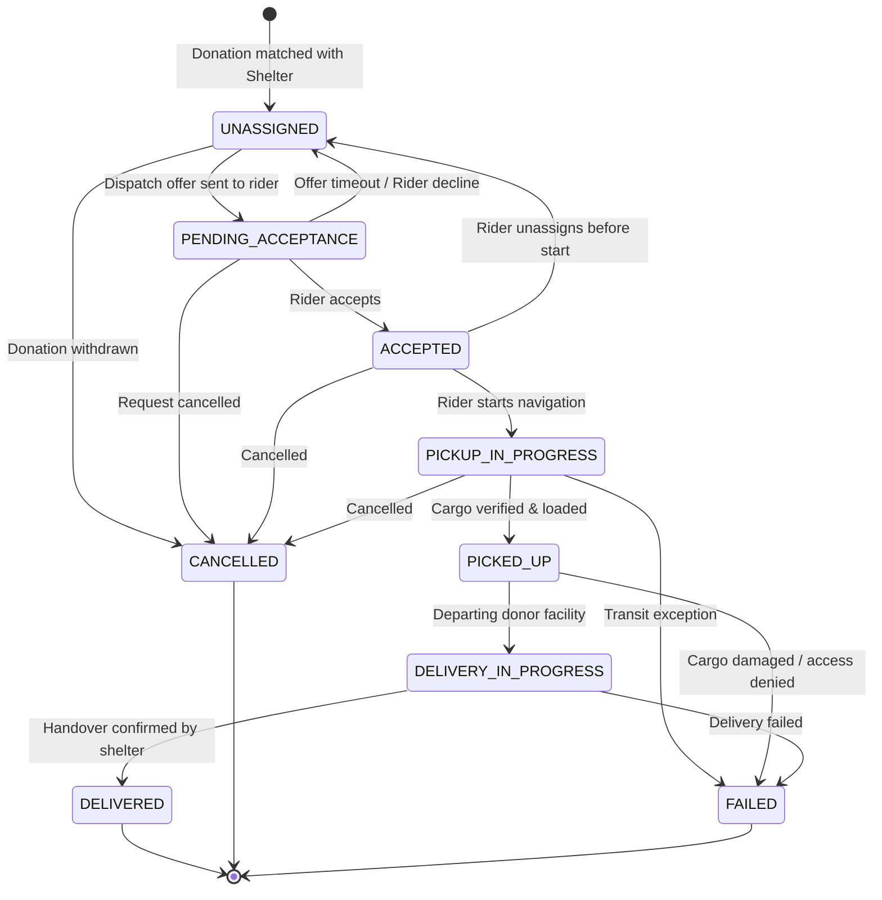

# AidFlow Assignment Lifecycle & State Machine

The delivery assignment lifecycle coordinates the physical transit of surplus food and essentials from donors to recipient shelters.

To avoid race conditions, double-pickups, or unverified deliveries, all state changes are strictly governed by a deterministic finite state machine implemented in `@aidflow/shared`.

---

## 1. Lifecycle States

| State | Type | Description |
|---|---|---|
| `UNASSIGNED` | Initial | Donation matched to a destination shelter, pending courier dispatch. |
| `PENDING_ACCEPTANCE` | Transient | Offered to an optimal rider; awaiting acceptance within timeout window. |
| `ACCEPTED` | Active | Rider accepted the dispatch task and committed to the pickup. |
| `PICKUP_IN_PROGRESS` | Active | Rider is navigating to the donor location. |
| `PICKED_UP` | Active | Items loaded and verified by rider at the donor facility. |
| `DELIVERY_IN_PROGRESS`| Active | Rider is en route from donor to the destination shelter. |
| `DELIVERED` | Terminal | Aid successfully handed over and receipt confirmed by shelter staff. |
| `CANCELLED` | Terminal | Discontinued by donor, shelter, or admin prior to delivery. |
| `FAILED` | Terminal | Transport failure (e.g., vehicle breakdown, spoilage, access denial). |

---

## 2. State Transition Matrix

The table below illustrates valid target states from each current state:

| Current Status | Permitted Next Statuses | Notes |
|---|---|---|
| `UNASSIGNED` | `PENDING_ACCEPTANCE`, `CANCELLED` | Cannot jump to active transit without an offer. |
| `PENDING_ACCEPTANCE` | `ACCEPTED`, `UNASSIGNED`, `CANCELLED` | If rider rejects or times out, reverts to `UNASSIGNED`. |
| `ACCEPTED` | `PICKUP_IN_PROGRESS`, `UNASSIGNED`, `CANCELLED` | Rider can unassign prior to departure; reverts to queue. |
| `PICKUP_IN_PROGRESS` | `PICKED_UP`, `CANCELLED`, `FAILED` | In-transit emergencies transition to `FAILED`. |
| `PICKED_UP` | `DELIVERY_IN_PROGRESS`, `FAILED` | Items loaded; cannot revert to `UNASSIGNED`. |
| `DELIVERY_IN_PROGRESS`| `DELIVERED`, `FAILED` | Final leg before drop-off. |
| `DELIVERED` | *None* | **Terminal State**. No further transitions permitted. |
| `CANCELLED` | *None* | **Terminal State**. Final audit status. |
| `FAILED` | *None* | **Terminal State**. Triggers exception review. |

---

## 3. State Transition Diagram

---

## 4. Enforcement Implementation

Transitions are validated in two independent layers:

1. **Shared Domain Layer (`@aidflow/shared`)**:
   `canTransitionAssignment(currentStatus, targetStatus)` executes pure state machine logic:
   - Returns `{ valid: true }` or `{ valid: false, reason: string }`.

2. **API Endpoint Layer (`apps/server`)**:
   `PATCH /api/assignments/:id/state` validates the transition payload. If invalid, the server responds with:
   - **HTTP 400 Bad Request**
   - Error code: `INVALID_STATE_TRANSITION`
   - Detailed rationale and permitted alternatives.
